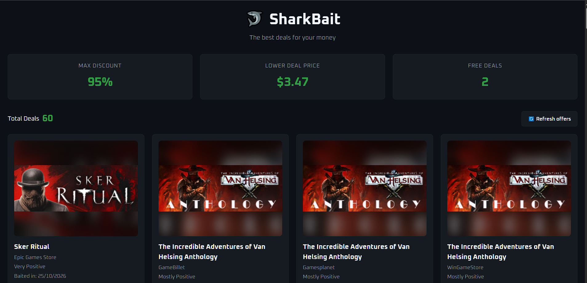

# **SHARK BAIT** 🦈 - A PIPELINE POWERED BY **CHEAPSHARK API** AND PYTHON

### THIS IS AN UPGRADE FOR MY CS50P PROJECT. FIRSTLY IT WAS A SIMPLE SCRIPT PIPELINE PRODUCING A CSV SORTED FILE. NOW ITS A COMPLETE INTEGRATED DATA PIPELINE SERVICE, AS FOLLOWS

🦈A Data Pipeline written in python that uses Cheapshark API offers to get, clean and show the best deals of PC games from multiple stores; store it on a database table and create a REST API containing such deals🦈

🦈Also includes a static web interface to consume that API and generate a useful visual design🦈


---

## WHY THIS PROJECT?

🦈**`Cheapshark` is a free and public API** that keeps track of PC digital games prices in different web stores, it returns these games with informations like the deal store, original and promotional price, thumb image, and game ratings from Steam and Metacritic. So, the API provides useful information for an application to look for games promotions

The original API acts as the data provider, but any data needs the *normalising, storage and some features additions*; thats where `SHARK BAIT` comes at hand providing a better structure to the game deals given by Cheapshark, aiming to hit on all this + more elements

🎣**`SHARK BAIT` offers these features:** robust ETL process; a database (using SQLite) storage; custom metrics; REST API channel ready to be consumed, with a web interface to experiment

* Also, this is my (officially) first project in my Computer Science (and Software Engineering general) career, so as well my objective was to take on a pretty familiar subject (games), from another project that simplifies the hard path (thank you cheapshark) and make my way to put my skills in testing with a pretty all round project (besides my focus in Data Engineering, for now just experimenting)


---

## HOW IT WORKS?

SHARK BAIT (main file, sharkbait.py) has 4 functions based on the central concept of data manipulation: ETL - Extract, Transform and Load, with an additional focused in the custom metrics manipulation; its designed as follows:

### 📥 extract 📥:
    
Powered by `requests` python library, it is the function that *takes responsibility to call **Cheapshark API** and ensure a safe response to the application*

- Starts by receiving a parameter called `page_size`, this is sent to the Cheapshark API to **control the number of games offers (or pages)**, by default request for **60** games (also the maximum supported for each API call)

- Then **set the headers and send a request to the API**, one for the **games deals** and another for the **stores** endpoint, using **raise_for_status** to catch an exception **when an error response occurs**

- Finally, *return the variables `data` for the game deals and `stores` for the stores dictionary*

### 🔄 transform 🔄:

Powered by `pandas` python library, it is the function that *takes responsibility to receive the dictionary from extract and create the dataframe (columns bidimensional structure), name the columns, normalize data types, treat null elements, calculate discount (`savings`), call `custom_metrics()` function and return the final dataframe* 

- Starts by receiving the parameters `data` and `stores`, <mark>two dictionary structures with the game deals and the store data</mark>; then list the essential parameters to be collected from Cheapshark response (**dealID, thumb, title, storeID, prices, ratings are in `data`** and **storeID equivalent storeName in `stores`**) and list how the columns will be named into the program; creates a panda dataframe with these features

- After that, check for any *null response* from the API in important columns to <mark>ensure a standard/place holder element or drop the deal (exclude) if the promotional price (price_now) or offer ID (dealID) is missing</mark> 
  - Also **transform prices and ratings elements into the float datatype**

- Proceeds to calculate the `savings` column, using the **Discount Percentage** formula: `savings = ((normal price - price now) / normal price) * 100`. Then, uses the `stores` dictionary to <mark>map each storeID column from the game deal for the respective storeName</mark>

- Finally, sends the clean dataframe to implement some *internal features in **custom_metrics** function*, receives the *final dataframe with both normalized and enriched data and sends to the load function*

## 📊 custom_metrics 📊:

Powered by `pandas` and `numpy` python libraries, it is the function that *takes responsibility to apply the business logic in original data to create new columns*.
Adds a *column for average ratings, apply this average rating and savings data to find a rate by price compensation score, drops (exclude) duplicates by dealID keeping the best score, find deals that are not games (such as DLC or in-game Packs) to set their score negative and return the enriched dataframe to `transform`*

- Starts by getting the transformed dataframe and calculating `critic_steam` metric; the formula used is:`critic steam = (metacritic * 0.3) + (steam_rate_percent * 0.7)`, this is, <mark>the final score is made by 70% of Steam rating and 30% of Metacritic rating</mark>. However, if **the metacritic rating is equals to 0, use:** `critic_steam = steam_rate_percent * 0.9`, this is, <mark>use the steam rating but with a -10% penalty</mark>
  * If <mark>the steam_rate_percent is equal to 0, use the same last formula, but with metacritic instead of steam rate</mark>; if <mark>both rating are equals to 0</mark>, take `critic_steam = 50.00` as standard.

- After that, takes the new metric for **another score, this one aim to find the sweet point between a game score rating and its price, called** `sort_rate_price` (because internally this metric is used to sort and dropping games). 
  * To find the games sort_rate_price metrics, use this formula: `sort_rate_price = critic_steam - (10 * log10(price_now + 1)) + (savings * 0.15)` (**this score point is limited to 100.00**), this is, <mark>the game score minus a logarithm price penalty (in base 10, which means highly differences "jumps" by n^10) plus the savings percentage to prevent games linear falling</mark>

- Plus, enhances the dataframe by <mark>sorting the deals with</mark> `sort_rate_price`, <mark>the highest to the lowest, and drop all same dealID deals keeping the first one (or, for the last line, the highest score to avoid bugs)</mark>
  * since the focus are the games, <mark>hunt deals with terms like "dlc", "pack", "upgrade", "expansion", "season pass" and "soundtrack" to take down in rate </mark>(`sort_rate_price = -100.00`) <mark>which are not full games, because some stores send them</mark>

- Finally, sends the enriched dataframe to `transform` function to proceed to load into the database

## 💾 load 💾:

- Powered by `sqlalchemy` (and `sqlite` under the table) and `pandas` python libraries, it is the function that *takes responsibility to save (or update) all game deals inside the dataframe in a database table, featuring an update feature if the game is already saved in the database and a rollback to ensure that the saving operation **HAS** to end without errors **OR** it does not saves anything*

- Starts by opening the session and **getting the statement SQL query and `on_conflict` set** (*if this element, dealID, already exists, ignore the upper statement and just to these updates*) *but execute it later*, use `.to_dict(orient="records")` function to <mark>transform the dataframe structure in a python dictionary where every line contains a full deal from the dataframe instead of column separated</mark>. 
  * An example is, instead of main dict `{'name': {0: 'item1', 1: 'item2'}, price: {0: 12, 1: 10}}` **orient="records" makes it** `[{'name': 'item1', 'price': 12},{'name': 'item2', 'price': 10}]`

- Finally, *execute the statement (or update statement), generating a print of the number of deals inserted*. But *if the operation* <mark>raises an exception **(has a error)**</mark>, takes to the **rollback** line, which <mark>**cancels** all the statement execution and **closes the session (effectively closing the program)**</mark>, leaving a print with the error raised*


---

## 🛠️ TECH STACK 🛠️

SHARK BAIT was built with these libraries and techs

* **Core:** `Python 3.x`
* **Data Processing:** `Pandas` & `NumPy` (clean, transform and custom metrics calculation)
* **Database & ORM:** `SQLite` & `SQLAlchemy` (relational persistence and Upsert/Rollback control)
* **API Integration:** `Requests` (consume Cheapshark API)
* **Testing:** `Pytest` & `Unittest.mock` (unit tests and error simulations)


---

## 🖥️ WEB INTERFACE 🖥️

Consuming the SHARK BAIT API, this project offers a simple digital storefront-like interface, using *HTML/CSS/JavaScript*. **check GETTING STARTED - USING STATIC INTERFACE** to use it; TAKE THIS EXAMPLE OVERVIEW:

<p align="center">
  
</p>

- *Overall info, such as <mark>max discount percentage, lowest game price and number of free games available</mark>; free deals are ignored from discount (would make always 100%) and lowest price (would make always 0.00)*

<p align="center">
  
</p>

- *Some games offers; they are shown as cards, with every individual info into it, such as: <mark>thumb (using transparent edge technique), store, steam rate, offer data (up to 2 days), Metacritic rate,</mark> `critic_steam` <mark>rate, price, savings and</mark> `sort_rate_price` <mark>final score</mark>; **free deals are shown in blue🔵; lowest price in yellow🟡***

---

## GETTING STARTED

### INSTALLATION

- Clone or Download this project folder
- Create and activate a virtual environment of python

```bash venv creation and activation
#Create venv
python -m venv venv # on Windows
python3 -m venv venv # on Linux/macOS
#Activating venv
.\Scripts\activate # on Windows
source venv/bin/activate # on Linux/macOS
```
- Install the required libraries listed in "requirements.txt":

```bash intall libraries
pip install -r requirements.txt
```

---


### HOW TO RUN

To execute this program run:

```bash 
python project.py # on Windows
python3 project.py # on Linux/macOS
```
- This will create/load an `sharkbait.db` file with the game deals (use a database SQLite viewer to explore the table)

---


### GET A TEST
To execute a test with the test_project.py file, using mocks, run:

```bash Test
pytest test_project.py -v #in the tests/ folder
#or
pytest tests/test_project.py -v #from root project folder
```

---


### USING STATIC INTERFACE

Once the data is load successfully into the database, you can see a visual demonstration:

- Navigate to the frontend/ (or static files) directory.

- Open index.html directly in your browser, or serve it using a local server (e.g., VS Code Live Server or python -m http.server).

- *Opening a Uvicorn and Python server example*:

1. From the root folder of the project, run the Uvicorn server:

```bash
# Run Uvicorn pointing to your FastAPI application
uvicorn api:app --port 8000 --reload
```

2. Open a new terminal and go to SHARK_BAIT/static folder; execute this to open python local server:

```bash
python -m http.server 5000
```

3. *Finally, go to the browser and open http://localhost:5000 to interact with the website*